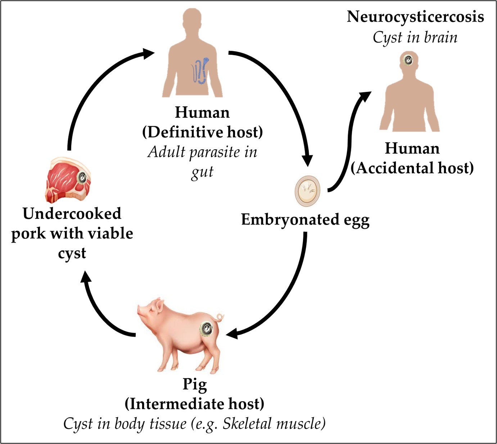
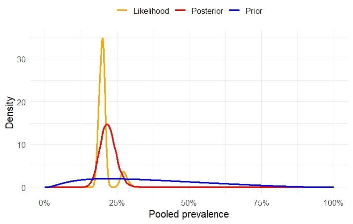
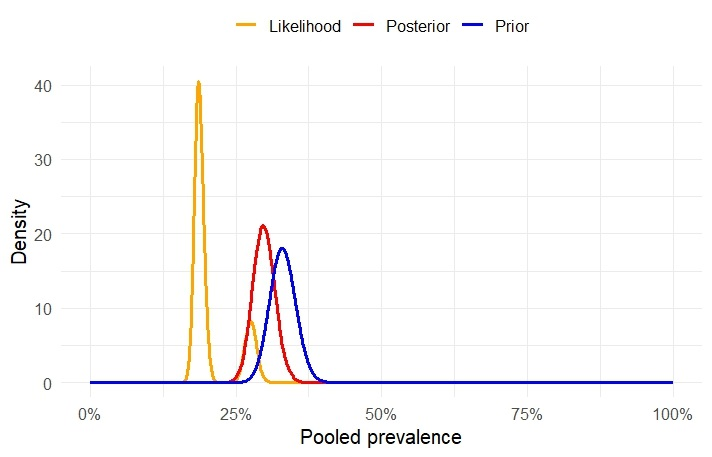
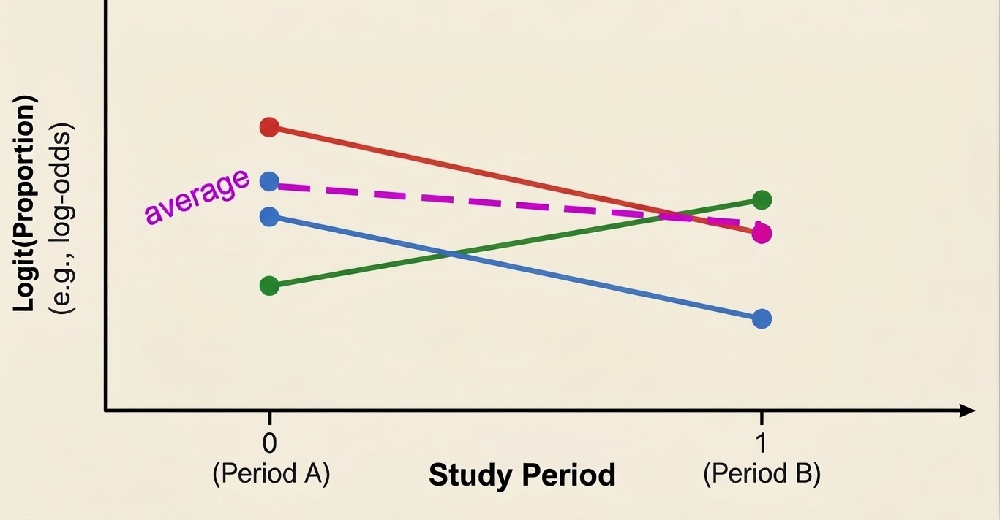

# **Disclaimer**

"*The purpose of this lecture is [**not to replace, dismiss, or undermine classical (frequentist) statistical approaches**]{style="color:red"} to meta-analysis. Rather, it is [**to introduce an alternative perspective**]{style="color:green"} and demonstrate how we can approach the same statistical questions from a Bayesian framework.*"

**No conflict of interest**

# **Introduction**

This script is designed to demonstrate how to conduct Bayesian meta-analysis and meta-regression. The primary focus is on the analysis of **prevalence studies**, with a brief introduction to meta-analysis of **association studies**.

## **What is a meta-analysis?**

Meta-analysis can be defined as a statistical tool or a formal process of combining the results from multiple studies [@dohoo2014]. This allows the analysis of the results from various scientific studies, which are often not performed in the same place or using the same method [@hackenberger2020bayesian]. Notably, both randomized clinical trials and observational studies are prone to a wide range of biases, and meta-analysis may lend spurious precision to questionable results. Therefore, the focus of meta-analysis of observational studies should be an evaluation of heterogeneity [@dohoo2014].

## **What is a proportion study?**

“Proportion study” is a study where the main outcome is a **proportion (e.g., prevalence, incidence, percentage)** of an event in a population.

For example:

- 25 people with epilepsy out of 100 participants
- 18% prevalence of a disease in a community

## **Why the meta-analysis of proportion is different?**

Most meta-analyses aim to evaluate the effect of an intervention or exposure compared with a comparator. The result is a pooled estimate of effect size which includes risk ratio, odds ratio, incidence rate ratio, or mean difference [@barker2021conducting]. In contrast, systematic reviews of studies estimating the proportion of a particular disease or health status typically involve a single study group, and the outcomes (e.g., prevalence, incidence, etc.) do not behave like conventional effect sizes. Some characteristics of the proportion are as follows:

- Proportions are bounded between 0 and 1, and do not behave like normal continuous data
- Variances are not constant
- Zero-event studies can happen. In that case, variance may become zero.
- Heterogeneity is usually very high

# **Information sources**

All workshop materials are available in the [GitHub repository](https://github.com/Baty2025/BMAR_Workshop).

**Note:** Download all files and keep them together in a single folder to ensure that the scripts run correctly.

The repository contains four folders:

- **Data:** All datasets used in the workshop.
- **Scripts:** All R scripts for conducting Bayesian meta-analysis and meta-regression.
- **Outputs:** Outputs generated from the analyses.
- **WWW:** PDF version of the PowerPoint presentation used during the workshop and some images that are required to render "**BMAR_Script.qmd**" file.

# **Setup**

This setup chunk checks for and installs the `pacman` package if necessary, then loads all the required R packages for the workshop. **Running this code should automatically install any missing packages and load all required packages.** If any errors occur, install the packages manually using the `install.packages()` function. Once successfully installed, load each package individually using the `library()` function.

```{r}
#| label: setup
#| echo: true
#| message: false
#| warning: false


if (!requireNamespace("pacman", quietly = TRUE)) {
  install.packages("pacman")
}


pacman::p_load(
  bayesmeta, bayestestR, bayesplot, binom, brms,
  DescTools, dplyr,
  extraDistr,
  flextable, forcats,
  ggdist, ggplot2, ggridges, glue, gt, gtsummary,
  here, 
  kableExtra, 
  loo, 
  meta, metafor,
  patchwork, posterior, 
  readxl, rstan, rstantools,
  scales, shinystan, stringr, 
  tictoc, tidybayes, tidyverse, tiff, 
  webshot2
)

theme_set(theme_minimal(base_size = 18))
```

# **Data**

In this workshop, we will use data from one of our published meta-analyses ([read the article](https://link.springer.com/article/10.1186/s40249-026-01501-1)). The original study aimed to estimate the prevalence of neurocysticercosis (NCC) among people with epileptic seizures. However, for simplicity, we will refer to this as estimating the **prevalence of NCC** throughout the workshop.

## **What is Neurocysticercosis (NCC)?**

Neurocysticercosis (NCC) is a parasitic infection of central nervous system caused by larval form (cysticerci) of zoonotic tapeworm *Taenia solium*.

{width="382"}

## **Our objectives**

- **What is the global prevalence of neurocysticercosis (NCC)?**
- **Has the prevalence of NCC changed since 2008? If so, what is the direction and magnitude of this change?**

## **Data collection**

**Database search → Systematic review → Quality assessment → Study selection (n = 77) → Data extraction (n = 47)**

For meta-analysis of prevalence, we primarily need three types of information from each study:

1.  **Study ID:** Unique identifier for each study.
2.  **Sample size (n):** Total number of participants examined.
3.  **Number of events (y):** Number of participants with the outcome of interest (or the reported effect size, when applicable).

In practice, we also collect other relevant variables (optional) to explore potential sources of heterogeneity in the reported estimates, such as:

- Geographical region
- Study period
- Age group
- Sex
- Diagnostic methods
- Study characteristics
- Other relevant factors

**Note:** These additional variables can be used as moderators in **subgroup analyses and meta-regression** to investigate potential sources of between-study heterogeneity.

We will mainly use three datasets throughout this workshop. Two are provided in the **Data** folder, while the third, `dat.bcg`, is available from the `metafor` R package.

- **`ncc_data.xlsx`:** Contains real data from our published meta-analysis, with some minor modifications for demonstration purposes. Therefore, the results may differ slightly from those reported in the original publication.
- **`ncc_data_by_gender.xlsx`:** A simulated dataset developed based on real data, designed to demonstrate sex-specific prevalence analysis and meta-regression.
- **`dat.bcg`:** A publicly available dataset included in the `metafor` package, commonly used to demonstrate meta-analysis of association measures.

## **Import first dataset**

```{r}
#| label: data
#| eval: true

ds <- read_xlsx(here("Data", "ncc_data.xlsx"))
```

## **Data exploration**

First, let's look at the variables and their structure

```{r}
#| label: variables
#| eval: true

colnames(ds)

```

Our dataset contains 15 variables. For the meta-analysis, we will primarily need three variables: **Study**, **y** (number of events), and **n** (total sample size).

Examine the first few rows of the dataset to become familiar with its structure.

```{r}
#| label: head
#| eval: true

head(ds)
```

We can check the summary statistics of all variables together

```{r}
#| label: var_summary
#| eval: true

summary(ds)
```

There appear to be **no missing values** in the dataset, as each variable contains 47 observations.

Next, examine the data types of the variables (e.g., character, integer, or numeric) to understand how each variable is stored in R.

```{r}
#| label: var_glimpse
#| eval: true

glimpse(ds)
```

Look at the **Study** variable. The `<chr>` label indicates that the values are stored as character data. This is appropriate because we want to keep the Study IDs as character variables.

Now, look at the **n** variable. The `<dbl>` label indicates that the values are stored as double-precision numeric data, which can include decimal numbers (e.g., `3.64`, `5.82`). However, the number of people tested (i.e., the sample size) must be a whole number. Therefore, we need to convert this variable to an integer (e.g., `4`, `6`).

The same applies to the **y** variable, which represents the number of events. It should also be stored as an integer.

```{r}
#| label: ny_conversion
#| eval: true

ds$n <- as.integer(ds$n) 
ds$y <- as.integer(ds$y) 

## Examin if changes happen or not
glimpse(ds)
```

We have successfully converted the variables to their appropriate data types. Now, let's prepare the dataset for meta-analysis by selecting and organizing the required variables: **Study**, **y** (number of events), and **n** (total sample size). Of note, we will also include `Study_period` variable.

## **Data set for meta-analysis**

```{r}
#| label: ma_data
#| eval: true

df1 <- ds %>% 
  select(Study,
         Study_period,
         n, 
         y)

```

# **Q1: Performing meta-analysis**

## **Step 1: Choosing the meta-analysis model**

The two main parametric models used to combine results from multiple studies are the fixed-effect (FE) and random-effects model (RE).

The FE model assumes that the true proportion is identical across studies included in meta-analysis, and any observed variation in proportion estimates is only due to random sampling error within each study, known as within-study variance.

In contrast, the RE model assumes the true proportions are not the same across studies but follow a normal distribution.

In other words, the RE model accounts for both within-study and between-study variances, while the FE model assumes that the between-study variance is zero (i.e., between-study heterogeneity does not exist) [@hackenberger2020bayesian; @wang2023conducting]. Hackenberger (2020) suggested the use of an FE model if there is no statistical or methodological heterogeneity and if it is not necessary to generalize the conclusions. If a generalized conclusion is the objective and data are available from more than five different studies, a RE model would be appropriate [@hackenberger2020bayesian; @munn2015methodological].

**In case of our example ..............**

Conceptually, there is little to no reason to assume that the underlying true prevalence of NCC is identical across all studies. Rather, we expect variation at two levels:

- **Within-study variance (sampling variability):** Even if the true prevalence in a particular population is fixed, repeated sampling from that population will produce slightly different prevalence estimates due to random sampling variation.

- **Between-study heterogeneity:** Different studies may investigate populations with different characteristics, geographical locations, age distributions, diagnostic methods, or other settings. Consequently, their underlying true prevalence may genuinely differ.

Therefore, we will use a **random-effects meta-analysis**, which accounts for both within-study sampling variability and between-study heterogeneity.

Before fitting the meta-analysis model, let's explore the variation in prevalence estimates across studies using a forest plot.

First, we will calculate the following study-specific quantities:

- $p_i$: Observed proportion (prevalence) in study ($i$).
- **lb:** Lower bound of the 95% confidence interval.
- **ub:** Upper bound of the 95% confidence interval.
- $v_i$: Sampling variance of the observed proportion.

Here, the sampling variance $v_i$ of a proportion is:

$$ v_i = \frac{p_i(1-p_i)}{n_i} $$

Where:

- $p_i = \frac{y_i}{n_i}$: observed proportion
- $n_i$: sample size
- $y_i$: number of events

Finally, let's create a **forest plot** to visualize the study-specific prevalence estimates and their corresponding 95% confidence intervals.

```{r}
#| label: forest_plot_1
#| eval: true

df1 <- df1 %>% 
  mutate(
    pi = binom.confint(y,n, method = "wilson")$mean,
    lb = binom.confint(y,n, method = "wilson")$lower,
    ub = binom.confint(y,n, method = "wilson")$upper,
    vi = (pi*(1-pi))/n
  ) 

## Another way of calculating proportion and variance 
# df1 <- escalc(
#   measure = "PR",
#   data = df1,
#   ni = df1$n,
#   xi = df1$y,
#   var.names = c("Raw_p","Raw_var")
# )

ggplot(df1,
       aes(x = pi,
           y = Study)) +
  geom_point(colour = "orange", size = 2) +
  geom_errorbar(
    aes(xmin = lb, xmax = ub)
  )+
  theme_minimal(base_size = 8) +
  labs(
    title = "Forest plot without pooled estimate",
    x = "Prevalence (95% CI)"
  ) +
  theme(
    panel.grid.minor = element_blank(),
    panel.grid.major.y = element_blank()
  )
```

The forest plot suggests considerable variation in prevalence estimates across studies, indicating potential between-study heterogeneity.

Additionally, check how the proportions are distributed

```{r}
#| label: data_distr
#| eval: true

plot(density(df1$pi),
     main = "Distribution of the reported proportions",
     xlab = "Study-specific prevalence",
     xlim = c(0, 1)
     )

# plot(density(df1$Raw_p),
#      main = "Distribution of the reported proportions",
#      xlab = "Study-specific prevalence",
#      xlim = c(0, 1)
# )
```

------------------------------------------------------------------------

::: callout-question
**Given the substantial heterogeneity observed across studies, should we still conduct a meta-analysis? Why or why not?**
:::

------------------------------------------------------------------------

## **Step 2: Estimating pooled proportion**

### **Frequentist meta-analysis (two-step method)**

The **two-step method** involves two main steps.

1.  First, we calculate the study-specific effect size (e.g., prevalence) and its corresponding sampling variance for each study.
2.  Second, we pool these estimates using a meta-analytic model, such as a random-effects model, which accounts for both within-study sampling variability and between-study heterogeneity.

Fortunately, we do not need to perform any calculations manually. There are R packages (such as - **`meta`** [@balduzzi2019], **`metafor`**[@viechtbauer2010]) available for conducting frequentist meta-analyses . In this workshop, we will use the **`metafor`** package.

#### **Option 1: using raw proportions**

As a thumb rule, if -

- The study proportions ($p_i$) are not too close to 0 or 1 (e.g., most are between 0.2 and 0.8), most favorably, around 0.5.
- Thee meta-analysis includes more than 10 studies.

We conduct **meta-analysis (two-step method) using raw proportions.**

```{r}
#| label: freq_raw_ma
#| eval: true


mod_raw <- metaprop(
  event = y,
  n = n,
  studlab = Study,
  data = df1,
  sm = "PRAW",
  method = "Inverse",
  method.tau = "DL",
  method.ci = "NAsm"
)

summary(mod_raw)
```

**Create a forest plot using `forest()` function**

```{r}
#| label: forest_plot_2
#| eval: true
#| fig-width: 14
#| fig-height: 10
#| out-height: 85%
#| fig-align: center


forest(
  mod_raw,
  common = FALSE,
  print.tau2 = TRUE,
  print.Q = TRUE,
  print.pval.Q = TRUE,
  print.I2 = TRUE,
  leftcols = c("studlab", "event", "n"),
  leftlabs = c("Study", "Cases", "Total"),
  xlab = "Prevalence",
  digits = 2,
  fontsize = 15,
  spacing = 0.9,
  col.square = "navy",
  col.square.lines = "navy",
  col.diamond = "maroon",
  col.diamond.lines = "maroon"
)
```

#### **Option 2: using logit transformed proportions**

The logit transformation is defined as:

$$  \text{logit}(p_i) = \log\left(\frac{p_i}{1-p_i}\right)$$

Where:

- $p_i$ = Observed prevalence in study $i$.
- $1-p_i$ = Proportion of participants without the outcome.
- $\log$ = Natural logarithm.

------------------------------------------------------------------------

::: callout-question
**Why do we apply logit transformation to prevalence estimates before conducting meta-analysis?**

**One major reason:** Prevalence is a proportion bounded between 0 and 1. However, conventional normal-based meta-analysis models work on an unbounded scale. The logit transformation transforms proportions between 0 and 1 into values ranging from negative to positive infinity.
:::

------------------------------------------------------------------------

After completing the meta-analysis, we transform the pooled estimate back to the original prevalence scale using the inverse logit transformation:

$$
P = \frac{\exp(\theta_i)}{1+\exp(\theta_i)}
$$

Where $\theta_i$ represents the logit-transformed prevalence.

```{r}
#| label: freq_logit_ma
#| eval: true


mod_logit <- metaprop(
  event = y,
  n = n,
  studlab = Study,
  data = df1,
  sm = "PLO",
  method = "Inverse",
  method.tau = "DL",
  method.ci = "NAsm"
)

summary(mod_logit)
```

**Create a forest plot using `forest()` function**

```{r}
#| label: forest_plot_3
#| eval: true
#| fig-width: 14
#| fig-height: 10
#| out-height: 85%
#| fig-align: center


forest(
  mod_logit,
  common = FALSE,
  print.tau2 = TRUE,
  print.Q = TRUE,
  print.pval.Q = TRUE,
  print.I2 = TRUE,
  leftcols = c("studlab", "event", "n"),
  leftlabs = c("Study", "Cases", "Total"),
  xlab = "Prevalence",
  digits = 2,
  fontsize = 15,
  spacing = 0.9,
  col.square = "navy",
  col.square.lines = "navy",
  col.diamond = "maroon",
  col.diamond.lines = "maroon"
)
```

[**Limitation of two steps method**]{style="color:red"}

1.  Might **not work well** when the **study sample sizes** are small.
2.  It may require the transformation of study-level proportions, and each transformation has its own limitations. For example, the log and logit transformations impractically treat within-study variances as fixed, known values and require *ad hoc* corrections for zero counts. The results from arcsine-based transformations may lack interpretability.

To overcome these limitation we can conduct meta-analysis using **generalized linear mixed model (GLMM).**

------------------------------------------------------------------------

::: callout-question
**What do we mean by generalized linear mixed model (GLMM)?**

**Answer:** A Generalized Linear Mixed Model (GLMM) is a statistical model that combines three components:

1.  **Generalized Linear Model (GLM):** Allows us to model different types of outcome data, such as binary, count, and continuous outcomes, using an appropriate probability distribution and link function.
2.  **Mixed-effects model:** Incorporates both fixed effects and random effects to account for variation across groups or clusters.
3.  **Link function:** Connects the expected outcome to the linear predictor.
:::

------------------------------------------------------------------------

### **Frequentist meta-analysis using generalized linear mixed model (GLMM)**

**Description:**

For each study, the observed number of events follows a binomial distribution:

$$ y_i \sim \text{Binomial}(n_i,p_i) $$

where:

- $y_i$ = number of events in study ($i$)
- $n_i$ = total sample size in study ($i$)
- $p_i$ = underlying event probability (prevalence) in study ($i$)

The logit transformation connects the study-specific prevalence to the linear predictor:

$$ \text{logit}(p_i)=\log\left(\frac{p_i}{1-p_i}\right) = P +\varepsilon_i $$

where:

- $P$ = overall mean log-odds of prevalence
- $\varepsilon_i$ = study-specific random effect

The study-specific random effects are assumed to follow a normal distribution:

$$ \epsilon_i \sim N(0,\tau^2) $$

- $\tau^2$ represents between-study variability.
- A larger ($\tau^2$) indicates greater variation in underlying prevalence across studies.

The estimated mean logit prevalence is transformed back to the probability scale:

$$ Prevalence  = \frac{\exp(\theta_i)}{1+\exp(\theta_i)} = \exp (P) $$

Where $\theta_i$ represents the logit-transformed prevalence.

Again, we don't have to perform all sorts of calculation manually, we will use `metaprop()` function from `metafor` package in R.

```{r}
#| label: freq_logit_ma_gllm
#| eval: true

mod_gllm <- metaprop(
  event = y,
  n = n,
  studlab = Study,
  data = df1,
  sm = "PLOGIT",
  method = "GLMM",
  common = FALSE,
  random = TRUE
)

summary(mod_gllm)
```

**Create a forest plot using `forest()` function**

```{r}
#| label: forest_plot_4
#| eval: true
#| fig-width: 14
#| fig-height: 10
#| out-height: 85%
#| fig-align: center


forest(
  mod_gllm,
  common = FALSE,
  print.tau2 = TRUE,
  print.Q = TRUE,
  print.pval.Q = TRUE,
  print.I2 = TRUE,
  leftcols = c("studlab", "event", "n"),
  leftlabs = c("Study", "Cases", "Total"),
  xlab = "Prevalence",
  digits = 2,
  fontsize = 15,
  spacing = 0.9,
  col.square = "navy",
  col.square.lines = "navy",
  col.diamond = "maroon",
  col.diamond.lines = "maroon"
)
```

------------------------------------------------------------------------

::: callout-question
**Question:** Our meta-analysis estimated the prevalence of neurocysticercosis (NCC) as **22% (95% confidence interval \[CI\]: 17%–27%)**.

**Which of the following is the correct interpretation?**

**A.** The estimated prevalence of NCC is 22%, and there is a 95% probability that the prevalence of NCC lies between 17% and 27%.

**B.** If we repeated the same meta-analysis many times using similar samples and methodology, approximately 95% of the calculated CI would contain the true pooled prevalence.

**C.** Exactly 22% of individuals worldwide have NCC, and 95% of the included studies reported prevalence estimates between 17% and 27%.
:::

------------------------------------------------------------------------

### **Bayesian meta-analysis**

Bayesian meta-analysis model is similar to the frequentist GLMM approach, but instead of treating the model parameters as fixed unknown quantities, **we assign probability distributions (priors) to them.**

$$
\small
\begin{aligned}
y_i &\sim \text{Binomial}(n_i, p_i) \\
\text{logit}(p_i) &= P + \varepsilon_i \\
P &\sim \text{uniform}(0,1)
\quad \text{OR} \quad
P \sim \text{Normal}(0,1) \\
\varepsilon_i &\sim \text{Normal}(0,\tau^2) \\
\tau &\sim \text{Half-Cauchy}(0,0.5)
\end{aligned}
$$

We call this model: **Bayesian random effects logistic models,** also known as **Bayesian multilevel/hierarchical models (BHM).**

We will fit the model using the **`brm()`** function from the **`brms`** R-package[@bürkner2017; @bürkner2018]. This package allow users to implement the Bayesian models in Stan’s probabilistic language from the R interface. Stan uses the No-U-Turn Sampler (NUTS), an extension of the Hamiltonian Monte Carlo (HMC) algorithm, for sampling.

::: callout-note
**How I conduct Bayesian data analysis in general?**

1.  Observe the data, and specify a **likelihood function**, such as - $y_i \sim \text{Binomial}(n_i, p_i)$ .
2.  Specify, **prior distributions** for model parameters.
3.  **Prior predictive check**
4.  Fit model
5.  Model diagnostics, including **posterior predictive check**
6.  Summarize posterior distributions
:::

------------------------------------------------------------------------

#### **Specifying the priors**

We need to assign prior distributions to the overall prevalence and the between-study heterogeneity parameter. In our BHM, this means specifying priors for the **`Intercept`** and **`sd`**, respectively.

There is no universally accepted guideline for selecting priors. However, it is good practice to visualize the proposed priors before fitting the model to assess whether they are reasonable in the context of our research question.

Since we are interested in prevalence on the probability scale (0–1), but `brms` specifies the model and applies priors on the logit scale, we should examine the implications of our priors on both scales.

**Note:** Simply plotting the prior density on the logit scale does not show how it translates into plausible prevalence values. To visualize the prior on the probability scale, we must first transform the logit-scale values using the inverse logit function. This helps us understand which prevalence values are considered plausible under our chosen priors.

1.  **Default prior available in brm() function**

```{r}
#| label: default_prior
#| eval: true

set.seed(123)
n_samples <- 10000
y <- rt(n_samples, df = 3) * 2.5
x <- plogis(y)

hist(x, breaks = 50, main = "Histogram of inv_logit(y) where y ~ Student_t(3, 0, 2.5)",
     xlab = "inv_logit(y)", col = "lightblue", border = "white")
```

So, on the probability scale, this prior behaves like an informative prior, assigning more probability to extreme prevalence values (closer to 0 or 1) than to values around 0.5.

2.  **Uniform (0,1)**

```{r}
#| label: unifrom_prior
#| eval: true
y <- runif(n_samples, min = 0, max = 1)
x <- plogis(y)
hist(x, breaks = 50, main = "Histogram of inv_logit(y) where y ~ Uniform(0, 1)",
     xlab = "inv_logit(y)", col = "lightblue", border = "white")
```

This prior is **not suitable** for our assumption that NCC prevalence could range from 0% to 100%, as it places most of its probability mass on prevalence values above 50%, giving insufficient support to lower prevalence values

3.  **Normal (0,1)**

```{r}
#| label: noraml_prior_1
#| eval: true
y <- rnorm(n_samples, mean = 0, sd = 1)
x <- plogis(y)


hist(x, breaks = 50, main = "Histogram of inv_logit(y) where y ~ Normal(0, 1)",
     xlab = "inv_logit(y)", col = "lightblue", border = "white")
```

This prior is comparatively better. However, it is not uninformative; rather, it is a **weakly informative prior**. Let's explore how changing the precision parameter affects the shape and spread of the prior distribution.

4.  **Normal (0,1.5)**

```{r}
#| label: noraml_prior_2
#| eval: true
y <- rnorm(n_samples, mean = 0, sd = 1.5)
x <- plogis(y)


hist(x, breaks = 50, main = "Histogram of inv_logit(y) where y ~ Normal(0, 1.5)",
     xlab = "inv_logit(y)", col = "lightblue", border = "white")
```

Yes, this prior looks much better and is more closely aligned with our assumptions about the possible range of NCC prevalence.

In the literature, the **Beta(1,1)** distribution is commonly used as a uniform prior on the probability scale. Let's explore how this prior looks on the logit scale.

5.  **Beta (1,1)**

```{r}
#| label: beta_prior
#| eval: true


y <- rbeta(n_samples, shape1 = 1, shape2 = 1)
x <- plogis(y)


hist(x, breaks = 50, main = "Histogram of inv_logit(y) where y ~ Beta(1, 1)",
     xlab = "inv_logit(y)", col = "lightblue", border = "white")
```

Interesting! We might not have expected this result, right? Although Beta(1,1) represents a uniform prior on the probability scale, its corresponding distribution on the logit scale looks quite different.

This highlights why it is important to examine priors on both scales. Let's try a new distribution that we have not discussed so far and see how it behaves on both scales.

6.  **logistic (0,1)**

```{r}
#| label: logistic_prior
#| eval: true


y <- rlogis(n_samples, location = 0, scale = 1)
x <- plogis(y)


hist(x, breaks = 50, main = "Histogram of inv_logit(y) where y ~ logistic(0, 1)",
     xlab = "inv_logit(y)", col = "lightblue", border = "white")
```

**Perfect! This is much closer to what we are looking for, right?** Compared with the **`Normal(0, 1.5)`** prior, the **`Logistic(0, 1)`** prior provides a more suitable distribution for our assumptions about NCC prevalence, allowing a reasonable range of prevalence values across the probability scale (0–100%). Therefore, we will use a **Logistic(0, 1) prior** for the overall prevalence parameter (`Intercept`) in our Bayesian hierarchical model.

------------------------------------------------------------------------

::: callout-note
The **logistic distribution** is a continuous, symmetric probability distribution characterized by two parameters: location and scale. The location parameter determines the centre of the distribution, while the scale parameter controls its spread. Similar to the normal distribution, it is symmetric around its centre, but it has heavier tails, assigning relatively more probability to values farther from the centre.
:::

------------------------------------------------------------------------

7.  **Prior for between-study heterogeneity parameter**

Earlier we assumed that -

$$
\tau \sim \text{Half-Cauchy}(0,0.5)
$$

Let's see how this look like

```{r}
#| label: cauchy_prior
#| eval: true


y <- rcauchy(n_samples, location = 0, scale = 0.5)


y_pos <- y[y > 0]

y_trim <- y_pos[y_pos < quantile(y_pos, 0.99)]


hist(y_trim, breaks = 100, freq = FALSE,
     main = "Half-Cauchy(0, 0.5) Prior for sd",
     xlab = "sd", col = "skyblue", border = "white")


lines(density(y_trim), col = "darkblue", lwd = 2)

```

That's ok. We are expressing our prior belief that the between-study heterogeneity (standard deviation, \\(\\tau\\)) is likely to be small, although larger values are also possible.

For the heterogeneity parameter, we commonly use a **half-Cauchy prior**. In `brms`, we can specify a full Cauchy distribution (e.g., `cauchy(0, 0.5)`), and because the standard deviation parameter (`sd`) is constrained to be non-negative, `brms` automatically uses only the positive part of the distribution. Thus, the resulting prior is a half-Cauchy distribution.

#### **Prior predictive distribution**

We have decide that, our prior will be-

$$
P \sim \text{Logistic}(0,1) \\
\tau \sim \text{Half-Cauchy}(0,0.5)
$$

"These priors encode assumptions about the kind of data we would expect to see in a future study. To understand these assumptions, we are going to generate data from the model; such distribution of data, which is generated entirely by the prior distributions, is called the prior predictive distribution."[@nicenboim2025]

Is simpler term, **we want to see if our prior generate the data that looks like our original data.**

```{r}
#| label: prior_pred_check
#| eval: true

set.seed(123)

N_samples <- 1000
N_studies <- nrow(df1)

# Overall intercept: Logistic(0, 1)
mu_samples <- rlogis(
  N_samples,
  location = 0,
  scale = 1
)

# mu_samples <- rnorm(
#   N_samples,
#   -1.386294,
#   1
# )

# Between-study heterogeneity: Half-Cauchy(0, 0.5)
tau_samples <- abs(
  rcauchy(
    N_samples,
    location = 0,
    scale = 0.5
  )
)


prior_pred <- map_dfr(seq_len(N_samples), function(i) {
  
  u <- rnorm(
    N_studies,
    mean = 0,
    sd = tau_samples[i]
  )
  

  p <- plogis(mu_samples[i] + u)
  

  y_pred <- rbinom(
    N_studies,
    size = df1$n,
    prob = p
  )
  
  tibble(
    Study = df1$Study,
    iter = i,
    mu = mu_samples[i],
    tau = tau_samples[i],
    u = u,
    p_pred = p,
    y_pred = y_pred,
    prevalence_pred = y_pred / df1$n
  )
})


# --------------------------------------------------
# Compare observed and simulated prevalence
# --------------------------------------------------

ggplot() +
  geom_density(
    data = prior_pred,
    aes(x = prevalence_pred),
    fill = "steelblue",
    alpha = 0.4
  ) +
  geom_density(
    data = df1,
    aes(x = y / n),
    color = "red",
    linewidth = 1
  ) +
  labs(
    title = "Observed vs prior predictive prevalence",
    x = "Prevalence",
    y = "Density"
  ) +
  scale_x_continuous(
    limits = c(0, 1),
    labels = label_percent()
  ) +
  theme_minimal()
```

The prior predictive distribution covers a broad range of prevalence values, reflecting our limited prior knowledge about the prevalence of NCC and the possibility of substantial between-study heterogeneity. Although the simulated distributions allow more extreme prevalence values than those observed in our dataset, the observed estimates remain within the range of values generated by the model. We therefore consider these priors reasonable for our initial analysis, while acknowledging the importance of sensitivity analyses to assess the influence of prior assumptions.

We can actually do the same analysis using `brm()` function

```{r}
#| label: prior_pred_check_2
#| eval: false

prior_set <- c(prior(logistic(0,1), class = "b", coef = "Intercept"),
               prior(cauchy(0,0.5), class="sd"))


prior_model <- brm(
  y | trials(n) ~ 0 + Intercept + (1 | Study),
  data = df1,
  family = binomial(link = "logit"),
  prior = prior_set,
  sample_prior = "only",
  chains = 4,
  iter = 2000,
  warmup = 1000,
  cores = 4,
  seed = 123
)


saveRDS(prior_model, here("Outputs", file = "prior_model.rds"))
```

Visualize the results

```{r}
#| label: prior_pred_check_3
#| eval: true

prior_model <- readRDS (here::here("Outputs","prior_model.rds"))

# Simulate replicated case counts
yrep <- posterior_predict(prior_model)


prior_pred <- as.data.frame(as.table(yrep)) %>%
  as_tibble() %>%
  mutate(
    Study = df1$Study[as.integer(Var2)],
    n = df1$n[as.integer(Var2)],
    prevalence_pred = Freq / n,
    iter = as.integer(Var1)
  )


ggplot() +
  geom_density(
    data = prior_pred,
    aes(x = prevalence_pred),
    fill = "steelblue",
    alpha = 0.4
  ) +
  geom_density(
    data = df1,
    aes(x = y / n),
    color = "red",
    linewidth = 1
  ) +
  scale_x_continuous(
    limits = c(0, 1),
    labels = label_percent()
  ) +
  labs(
    title = "Observed vs prior predictive prevalence",
    x = "Prevalence",
    y = "Density"
  ) +
  theme_minimal()
```

We can look at the estimates for both parameters separately

```{r}
#| label: prior_pred_check_4
#| eval: true


prior_draws <- posterior::as_draws_df(prior_model) %>%
  as.data.frame()


prior_parameters <- prior_draws %>%
  transmute(
    prevalence = plogis(b_Intercept),
    tau = sd_Study__Intercept
  )


p1 <- ggplot(prior_parameters, aes(x = prevalence)) +
  geom_density(fill = "steelblue", alpha = 0.5) +
  scale_x_continuous(
    limits = c(0, 1),
    labels = scales::label_percent()
  ) +
  labs(
    title = "Prior distribution of Ps",
    x = "Overall prevalence",
    y = "Density"
  ) +
  theme_minimal()

# Plot 2: Between-study heterogeneity prior
p2 <- ggplot(prior_parameters, aes(x = tau)) +
  geom_density(fill = "orange", alpha = 0.5) +
  coord_cartesian(xlim = c(0, 3)) +
  labs(
    title = "Prior distribution of Tau",
    x = expression("Between-study SD (" * tau * ")"),
    y = "Density"
  ) +
  theme_minimal()


combined_plot <- p1 + p2 +
  patchwork::plot_layout(ncol = 2)


print(combined_plot)
```

#### **Model fitting**

We can write prior within `brm()` function or outside the function.

```{r}
#| label: prior_set
#| eval: true
prior_set <- c(prior(logistic(0,1), class = Intercept),
               prior(cauchy(0,0.5), class=sd))
```

For model fitting, we will run **four Markov chains**, each with **10,000 iterations**, including **5,000 warm-up (burn-in) iterations**. This provides 20,000 post-warm-up iterations in total across the four chains, helping us obtain reliable posterior estimates and assess model convergence.

```{r}
#| label: bayes_ma
#| eval: false

b_ma_mod <-brm(
  y|trials(n)~(1|Study),
  data=df1,
  prior=prior_set,
  family=binomial(),
  chains = 4, 
  iter=10000,
  warmup = 5000,
  control = list(adapt_delta = 0.80),
  seed = 123)

# Save the model
saveRDS(b_ma_mod, here("Outputs", file = "b_ma_mod.rds"))
```

## **Step 3: Checking model diagnostics**

To evaluate the performance and convergence of the Bayesian model, we will conduct two important diagnostic checks: the **trace plot** and the **posterior predictive check**.

- The **Trace Plot** helps verify that the MCMC chains have converged and are mixing properly, with no trends or non-random behavior.
- The **Posterior Predictive Check** compares simulated data sets from the posterior distribution with the observed data to assess model fit.

This combined explanation should provide clarity on both diagnostic checks and their importance in the model validation process.

Before that let's see if our priors assigned as we wished

```{r}
#| label: ma_mod_priors
#| eval: true
b_ma_mod <- readRDS (here::here("Outputs","b_ma_mod.rds"))
prior_summary(b_ma_mod)

```

Look, priors worked perfectly :)

Now, check different plots

```{r}
#| label: ma_mod_diagostics
#| eval: true

b_ma_mod <- readRDS (here::here("Outputs","b_ma_mod.rds"))


plot(b_ma_mod,warmup=1000)

pp_check(b_ma_mod) 


# launch_shinystan(b_ma_mod)
```

## **Step 4: Inspecting and interpreting the model summary**

### **Proportion in logit scale**

We will use two function here -

- **`summary()`**: This function provides a summary of the model's fixed and random effects. Specifically, it presents the **intercept** parameter, which is expressed in the **logit scale**. The logit scale is the default for binomial models, representing the log-odds of the outcome. The summary also includes information about the standard deviations, **credible intervals**, and other model diagnostics, giving an overview of the model fit and the parameter estimates.

- **`posterior_summary()`**: This function provides a summary of the **posterior distributions** for each study. It reports the posterior estimates in the **logit scale** for each study-specific random effect (i.e., random intercept). This is useful for examining the variability of NCC prevalence across different studies and understanding how much study-level variability is explained by the random intercepts. The posterior summaries include the point estimates, credible intervals, and the uncertainty of the random effects, helping assess how each study contributes to the overall meta-analysis.

Together, these functions allow for a comprehensive review of the model’s fixed and random effects, summarizing the overall effect of NCC prevalence across studies (fixed intercept) and the variation in estimates between studies (random intercepts).

```{r}
#| label: ma_mod_summary
#| eval: true

summary(b_ma_mod)

#posterior_summary(b_ma_mod) #Posterior estimate (in logit scale) for each study

```

But the outputs are in logit scale. We need to back-transform to probability scale

### **Converting the estimate into probability scale**

- **`fixef() %>% plogis()`**: The `fixef()` function extracts the **fixed effect estimates** (e.g., the intercept and any other fixed predictors) from the model, which are originally expressed in **log-odds (logit)** scale. The `plogis()` function then converts these estimates from the logit scale to the **probability scale**. This transformation is necessary because the logit scale represents log-odds, and converting it to the probability scale allows for easier interpretation of the results, as probabilities range from 0 to 1. This step helps to understand the proportion of NCC in more intuitive terms.

```{r}
#| label: ma_mod_summary_mean
#| eval: true

#posterior_summary(b_ma_mod) %>% plogis() #Posterior estimate (in probability scale) for each study
fixef(b_ma_mod) %>% plogis()
```

Of note, the `Estimate` presented here is actually mean. But usually we report median.

```{r}
#| label: ma_mod_summary_median
#| eval: true


posterior_draw <- as_draws_array(b_ma_mod)


posterior <- posterior_draw %>% 
  rename_variables(
    Proportion = "b_Intercept",
    tau = "sd_Study__Intercept"
  ) %>% 
  mutate_variables(
    Proportion = plogis(Proportion)
  )


summary_results <- as_draws_df(posterior) %>%
  summarise(
    across(
      c(Proportion, tau),
      list(
        Median = ~ median(.x),
        Lower_95 = ~ quantile(.x, 0.025),
        Upper_95 = ~ quantile(.x, 0.975)
      ),
      .names = "{.col}_{.fn}"
    )
  ) %>%
  pivot_longer(
    cols = everything(),
    names_to = c("Parameter", ".value"),
    names_pattern = "^(Proportion|tau)_(Median|Lower_95|Upper_95)$"
  )

summary_results


```

Of note, between-study heterogeneity ($\tau$) is already on the logit scale, and it should not be transformed.

**Results:** The posterior median pooled prevalence was 21.9% (95% Bayesian credible interval \[CrI\]: 17.1%–27.9%).

**Interpretation:** ***The Bayesian random-effects meta-analysis estimated a pooled prevalence of 21.9% (95% CrI: 17.1%–27.9%). This indicates that, given the observed data and the specified model and prior distributions, the posterior probability that the pooled prevalence lies between 17.1% and 27.9% is 95%.***

Or simply,

[***The pooled prevalence of NCC was estimated at 21.9% (95% CrI: 17.1%–27.9%). There is a 95% posterior probability that the true pooled prevalence lies between 17.1% and 27.9%.***]{style="color:red"}

## **Step 5: Sensitivity analysis**

For sensitivity, analysis we have repeat the whole process again and again!! Earlier we found that $Normal(0,1.5)$ was another prior that make sense to our assumption. Let's use that:

```{r}
#| label: se_normal_prior
#| eval: false

prior_set <- c(prior(normal(0,1.5), class = Intercept), ## Only change here
               prior(cauchy(0,0.5), class=sd))

b_ma_mod_1 <-brm(                        ## Give new model name
  y|trials(n)~(1|Study),
  data=df1,
  prior=prior_set,
  family=binomial(),
  chains = 4, 
  iter=10000,
  warmup = 5000,
  control = list(adapt_delta = 0.80),
  seed = 123)

# Save the model
saveRDS(b_ma_mod_1, here("Outputs", file = "ma_se_norm_p.rds"))

```

Check the outputs

```{r}
#| label: se_normal_prior_results
#| eval: false

b_ma_mod_1 <- readRDS (here::here("Outputs", "ma_se_norm_p.rds"))

summary(b_ma_mod_1)
fixef(b_ma_mod_1) %>% plogis()
pp_check(b_ma_mod_1)
prior_summary(b_ma_mod_1)

```

The results have hardly changed!

Have you noticed that we keep obtaining almost identical results, again and again? But why?

Because, so far, we have assumed that we have very little prior knowledge about NCC prevalence, beyond knowing that it must lie between 0% and 100%. Consequently, our prior distributions provide relatively little informative guidance, allowing the observed data to have a greater influence on the posterior estimates.

In other words, the data are dominating the posterior estimates because our priors are relatively weakly informative.

**What happens if we incorporate existing evidence?**

For example, suppose a previous meta-analysis estimated the prevalence of neurocysticercosis (NCC) before 2005 to be **33% (95% CI: 29%–37%)**.

**What if we use this published estimate to construct an informative prior distribution for our Bayesian meta-analysis? Will the posterior estimates change? If so, how much influence will this previous evidence have on our results?**

First, visualize the prior

```{r}
#| label: infor_prior
#| eval: true

log(0.33/(1-0.33)) 

y <- rnorm(n_samples, mean = -0.7081851, sd = 1)
x <- plogis(y)


hist(x, breaks = 50, main = "Histogram of inv_logit(y) where y ~ Normal(0.33, 1)",
     xlab = "inv_logit(y)", col = "lightblue", border = "white")
```

Is this informative?, no, rather we can say weakly informative prior

Fit a new model

```{r}
#| label: infor_prior_ma
#| eval: false


prior_set <- c(prior(normal(-0.7081851,1), class = Intercept), 
               prior(cauchy(0,0.5), class=sd))

b_ma_mod_2 <-brm(                        
  y|trials(n)~(1|Study),
  data=df1,
  prior=prior_set,
  family=binomial(),
  chains = 4, 
  iter=10000,
  warmup = 5000,
  control = list(adapt_delta = 0.80),
  seed = 123)

# Save the model
saveRDS(b_ma_mod_2, here("Outputs", file = "ma_se_norm_0.33.rds"))
```

Check the outputs

```{r}
#| label: infor_prior_ma_results
#| eval: true

b_ma_mod_2 <- readRDS (here::here("Outputs", "ma_se_norm_0.33.rds"))

summary(b_ma_mod_2)
fixef(b_ma_mod_2) %>% plogis()
pp_check(b_ma_mod_2)
prior_summary(b_ma_mod_2)
```

Still, there is no change

Just for fun let make the prior a bit more informative

```{r}
#| label: infor_prior_2
#| eval: true

y <- rnorm(n_samples, mean = log(0.33/(1-0.33)), sd = 0.1)
x <- plogis(y)


hist(x, breaks = 50, main = "Histogram of inv_logit(y) where y ~ Normal(0.33, 0.1)",
     xlab = "inv_logit(y)", col = "lightblue", border = "white")
```

Fit the model

```{r}
#| label: infor_prior_ma_2
#| eval: false


prior_set <- c(prior(normal(-0.7081851,0.1), class = Intercept), 
               prior(cauchy(0,0.5), class=sd))

b_ma_mod_3 <-brm(                        
  y|trials(n)~(1|Study),
  data=df1,
  prior=prior_set,
  family=binomial(),
  chains = 4, 
  iter=10000,
  warmup = 5000,
  control = list(adapt_delta = 0.80),
  seed = 123)

# Save the model
saveRDS(b_ma_mod_3, here("Outputs", file = "ma_se_norm_0.33_0.1.rds"))
```

Check the results

```{r}
#| label: infor_prior_ma_2_results
#| eval: true

b_ma_mod_3 <- readRDS (here::here("Outputs", "ma_se_norm_0.33_0.1.rds"))

summary(b_ma_mod_3)
fixef(b_ma_mod_3) %>% plogis()
pp_check(b_ma_mod_3)
prior_summary(b_ma_mod_3)
```

I have prepared two plots just for demonstration

::::: columns
::: {.column width="50%"}

:::

::: {.column width="50%"}

:::
:::::

Note that, we are showing approximate data, BUT still we can see the effect of prior.

## **Step 6: Visualizing results**

#### **Joint density plot**

The purpose of this code is to visualize the results of the Bayesian meta-analysis using a **joint density plot**, which illustrates both the **mean effect** and the **heterogeneity** (study-level variability) in the meta-analysis. This visualization is helpful for understanding the distribution of the posterior estimates for the **proportion of NCC** and the variability between studies.

```{r}
#| label: jd_plot
#| eval: true


if (requireNamespace("hexbin", quietly = TRUE)) { 
  mcmc_hex(posterior, pars = c("Proportion", "tau")) 
}
```

#### **Forest plot of estimated proportions**

```{r}
#| label: forest_plot_final
#| warning: false
#| message: false
#| eval: true
#| fig-width: 14
#| fig-height: 10
#| out-height: 85%
#| fig-align: center


study.draws <- spread_draws(b_ma_mod, 
                            r_Study[Study,], 
                            b_Intercept) %>%
  mutate(b_Intercept = r_Study + b_Intercept) 


pooled.effect.draws <- spread_draws(b_ma_mod, 
                                    b_Intercept) %>%
  mutate(Study = "Pooled Effect") 


forest.data <- bind_rows(study.draws, 
                         pooled.effect.draws) %>%
  ungroup() %>%
  mutate(b_Intercept = plogis(b_Intercept)) %>% 
  mutate(Study = str_replace_all(Study, "[.]", " ")) %>% 
  mutate(Study = reorder(Study, 
                         b_Intercept, 
                         decreasing = F)) 


forest.data$Study <- factor(forest.data$Study)


forest.data.summary <- group_by(forest.data, 
                                Study) %>%
  median_qi(b_Intercept) 

p <- ggplot(aes(b_Intercept, 
           relevel(Study, 
                   "Pooled Effect", 
                   after = Inf)), 
       data = forest.data) +
  geom_vline(xintercept = plogis(fixef(b_ma_mod)[1, 1]), 
             color = "#E64B35", 
             size = 1) + 
  geom_vline(xintercept = plogis(fixef(b_ma_mod)[1, 3:4]), 
             color = "grey", 
             linetype = 2) + 
  geom_density_ridges(
    aes(fill = Study),
    rel_min_height = 0.01,
    col = NA,
    scale = 1,
    alpha = 1
  ) +
  scale_fill_manual(
    values = c(
      "Pooled Effect" = "#E64B35",
      setNames(
        rep("#4292C6", length(setdiff(
          levels(forest.data$Study), "Pooled Effect"
        ))),
        setdiff(levels(forest.data$Study), "Pooled Effect")
      )
    ),
    guide = "none"
  )  + 
  stat_pointinterval(.width = 0.95, 
                     linewidth = 0.5) + 
  geom_text(data = mutate_if(forest.data.summary, 
                             is.numeric, 
                             round, 2), 
            aes(label = glue("{b_Intercept} [{.lower}, {.upper}]"),x = Inf), 
            hjust = "inward") + 
  labs(x = "Estimated Proportion", 
       y = NULL, 
       title = "Estimated Proportion \n(95%BCI)", 
       subtitle = "Study") + 
  theme_minimal() + 
  theme(
    text = element_text(family = "Times"), 
    axis.title.x = element_text(size = 14, family = "Times", colour = "black"), 
    axis.text.x = element_text(size = 10, family = "Times", colour = "black"), 
    axis.title.y = element_text(size = 10, family = "Times", colour = "black"), 
    axis.text.y = element_text(size = 10, family = "Times", colour = "black"), 
    plot.title = element_text(hjust = 1, size = 12, family = "Times", face = "bold"), 
    plot.subtitle = element_text(hjust = -0.1, size = 12, family = "Times", face = "bold"), #
    plot.margin = margin(20, 20, 40, 20), 
    legend.text = element_text(size = 10, family = "Times"), 
    legend.title = element_text(size = 12, family = "Times"), 
    axis.line = element_line(size = 0.5), 
    panel.grid.major = element_blank(), 
    panel.grid.minor = element_blank() 
  )
p

```

We can save this plot

```{r}
#| label: save_fp
#| eval: false

ggsave(
  here("Outputs", "stan_forest_plot.pdf"),
  plot = p,
  width = 10,
  height = 8,
  unit = "in"
)

```

## **Fitting model in Stan (just for validation)**

Now. as i said earlier, `brm()` function actually write code in `stan`. Let's see how it looks like

```{r}
#| label: stan_code
#| eval: false

stan_model <- "
  data{
    int<lower = 1> N; 
    array[N] int<lower = 0> n;
    array[N] int<lower = 0> y;
  }
  
 parameters{
   real mu;
   real <lower = 0> sigma;
   vector[N] theta;
 } 
 
 model{
   mu ~ logistic(0,1);
   sigma ~ cauchy(0,0.5);
   
   theta ~ normal(mu,sigma);
   
   y ~ binomial_logit(n,theta);
   
 }
 
 generated quantities {
   real pooled_prevalence;
   vector[N] prevalence;
   
   pooled_prevalence = inv_logit(mu);
   prevalence = inv_logit(theta);
 }
"

stan_data <- list(
  N = nrow(df1),
  n = as.integer(df1$n),
  y = as.integer(df1$y)
)


stan_ma_mod <- stan(
  model_code = stan_model,
  data = stan_data,
  chains = 4,
  iter = 10000,
  warmup = 5000,
  seed = 123
)


saveRDS(stan_ma_mod, here("Outputs", file = "stan_ma_mod.rds"))
```

Of note, here we are using a new parameter `theta` in parameters block. This is not necessary in `brm()` model. idea is, we are saying -

$$
\theta = logit(pi)
$$ That meas we are converting raw study specific proportion into logit scale.

### **Model diagnostics**

```{r}
#| label: stan_ma_diag
#| eval: true
stan_ma_mod <- readRDS (here::here("Outputs","stan_ma_mod.rds"))

summary(
  stan_ma_mod ,
  pars = c("mu", "sigma", "pooled_prevalence")
)$summary
```

#### **Trace plot**

```{r}
#| label: stan_tp
#| eval: true

mcmc_trace(
  as.array(stan_ma_mod),
  pars = c("mu", "sigma")
)
```

#### **Posterior distribution**

```{r}
#| label: stan_pd
#| eval: true

mcmc_hist(
  as.array(stan_ma_mod),
  pars = c("mu", "sigma")
)
```

#### **Check divergent transitions**

```{r}
#| label: stan_div
#| eval: true

sampler_params <- get_sampler_params(
  stan_ma_mod,
  inc_warmup = FALSE
)

sum(sapply(
  sampler_params,
  function(x) sum(x[, "divergent__"])
))
```

### **Results**

```{r}
#| label: stan_ma_results
#| eval: true


stan_post_draws <- rstan::extract(stan_ma_mod)

# stan_ma_results <- data.frame(
#   Study = df1$Study,
#   Median = apply(stan_post_draws$prevalence, 2, median),
#   Lower = apply(stan_post_draws$prevalence, 2, quantile, 0.025),
#   Upper = apply(stan_post_draws$prevalence, 2, quantile, 0.975)
# )
# 
# stan_ma_results

quantile(
  stan_post_draws$pooled_prevalence,
  probs = c(0.025, 0.50, 0.975)
)

```

# **Q2: Performing sub-group analysis and meta-regression**

I hope you remember that we have another important research question to address:

- **Has the prevalence of NCC changed after 2008? If so, what is the direction and magnitude of the change?**

To investigate this question, we will classify studies into two periods:

1.  **Period A (1990–May 2008):** Studies conducted between January 1990 and May 2008, coded as `0`.

2.  **Period B (June 2008–May 2023):** Studies conducted between June 2008 and May 2023, coded as `1`.

**Note:** Each study contributes only one data point to our dataset. Therefore, each study is assigned to either Period A or Period B, depending on its study period.

## **Sub-group analysis**

Subgroup analysis is useful when we want to compare pooled estimates across predefined categories of a study characteristic.

**Example:** Compare pooled NCC prevalence between Period A and Period B.

1.  **Estimate prevalence of NCC for period A**

```{r}
#| label: bayes_ma_periodA
#| eval: false
#| message: false
#| warning: false

b_ma_mod_periodA <-brm(
  y|trials(n)~(1|Study),
  data=df1 %>% filter(Study_period == "A"),
  prior=c(prior(logistic(0,1), class = Intercept),
          prior(cauchy(0,0.5), class=sd)),
  family=binomial(),
  chains = 4, 
  iter=10000,
  warmup = 5000,
  control = list(adapt_delta = 0.80),
  seed = 123)

# Save the model
saveRDS(b_ma_mod_periodA, here("Outputs", file = "b_ma_mod_periodA.rds"))
```

2.  **Estimate prevalence of NCC for period B**

```{r}
#| label: bayes_ma_periodB
#| eval: false
#| message: false
#| warning: false

b_ma_mod_periodB <-brm(
  y|trials(n)~(1|Study),
  data=df1 %>% filter(Study_period == "B"),
  prior=c(prior(logistic(0,1), class = Intercept),
          prior(cauchy(0,0.5), class=sd)),
  family=binomial(),
  chains = 4, 
  iter=10000,
  warmup = 5000,
  control = list(adapt_delta = 0.80),
  seed = 123)

# Save the model
saveRDS(b_ma_mod_periodB, here("Outputs", file = "b_ma_mod_periodB.rds"))
```

3.  **Compare the estimates**

```{r}
#| label: A_and_B_results
#| eval: true

b_ma_mod_periodA <- readRDS (here::here("Outputs","b_ma_mod_periodA.rds"))
b_ma_mod_periodB <- readRDS (here::here("Outputs","b_ma_mod_periodB.rds"))

draws_A <- as_draws_df(b_ma_mod_periodA)
draws_B <- as_draws_df(b_ma_mod_periodB)

prev_A <- plogis(draws_A$b_Intercept)
prev_B <- plogis(draws_B$b_Intercept)


results <- tibble(
  Period = c("Period A", "Period B"),
  Median = c(median(prev_A), median(prev_B)),
  Lower = c(
    quantile(prev_A, 0.025),
    quantile(prev_B, 0.025)
  ),
  Upper = c(
    quantile(prev_A, 0.975),
    quantile(prev_B, 0.975)
  )
) %>%
  mutate(
    across(c(Median, Lower, Upper), ~ .x * 100)
  )

print(results)


```

We can compare based on difference

```{r}
#| label: A_vs_B
#| eval: true

# Difference in prevalence (Period B - Period A)
difference <- prev_B - prev_A

difference_results <- tibble(
  Median_difference = median(difference) * 100,
  Lower_95_CrI = quantile(difference, 0.025) * 100,
  Upper_95_CrI = quantile(difference, 0.975) * 100,
  Probability_increase = mean(difference > 0),
  Probability_decrease = mean(difference < 0)
)

print(difference_results)
```

We can also visualize the results

```{r}
#| label: A_vs_B_plot
#| eval: true

plot_data <- results %>%
  mutate(Period = factor(Period, levels = c("Period A", "Period B")))

p1 <- ggplot(
  plot_data,
  aes(x = Period, y = Median)
) +
  geom_point(size = 3) +
  geom_errorbar(
    aes(ymin = Lower, ymax = Upper),
    width = 0.15,
    linewidth = 0.8
  ) +
  labs(
    title = "Pooled NCC prevalence by study period",
    x = NULL,
    y = "Prevalence (%)"
  ) +
  theme_minimal()


p2 <- ggplot(
  tibble(difference = difference * 100),
  aes(x = difference)
) +
  geom_density(
    fill = "steelblue",
    alpha = 0.5
  ) +
  geom_vline(
    xintercept = 0,
    linetype = "dashed"
  ) +
  labs(
    title = "Posterior distribution of the difference",
    x = "Difference in prevalence (B - A), percentage points",
    y = "Density"
  ) +
  theme_minimal()

# Combine plots
p1 + p2 + plot_layout(ncol = 2)
```

We can even see the probability of the pooled prevalence in Period B is lower than that in Period A

```{r}
#| label: A_vs_B_probability
#| eval: true

prob_B_lower <- mean(prev_B < prev_A)

prob_B_lower
```

**Interpretation:** There is a 98.3% posterior probability that prevalence was lower in Period B.

However, this is a comparison of subgroup estimates, not an adjusted temporal association. We can address possible association using meta-regression.

## **Bayesian meta-regression**

Meta-regression is useful when we want to investigate whether study-level characteristics (moderators) are associated with variation in prevalence estimates across studies.

### **Bayesian mixed-effect logistic regression model**

Assuming the outcome is the number of studies reporting a particular manifestation relative to the total number of studies assessing that manifestation, the model is specified as follows:

$$
y_i \sim \operatorname{Binomial}(n_i,p_i)\\
\operatorname{logit}(p_i) = P + \beta_1 \operatorname{Period}_i + \varepsilon_i\\
\varepsilon_i \sim \operatorname{Normal}(0,\tau^2)
$$

Where:

- $y_i$: Number of studies reporting the manifestation.
- $n_i$: Total number of studies assessing the manifestation.
- $p_i$: Underlying proportion of studies reporting the manifestation.
- $\operatorname{Period}_i = 0$: Period A.
- $\operatorname{Period}_i = 1$: Period B.
- $P$: Log-odds of the proportion in Period A
- $\beta_1$: Difference in log-odds between Period B and Period A.
- $\varepsilon_i$: Study-specific random intercept, representing the deviation of study $i$ from the overall intercept ($P$). It accounts for between-study heterogeneity in the underlying proportion.
- $\tau$: Between-study heterogeneity (standard deviation of the random intercept).

The key parameter of interest is $\beta_1$, which indicates the direction and magnitude of the change in the log-odds of reporting the manifestation in Period B compared with Period A.

- $\beta_1 > 0$: The proportion increased in Period B.
- $\beta_1 < 0$: The proportion decreased in Period B.
- $\beta_1 = 0$: No difference between the two periods.

The exponentiated coefficient, $\exp(\beta_1)$, represents the odds ratio comparing Period B with Period A.

If see in picture:


Notice that we now have a new parameter, $\beta_1$, in our model. Therefore, we need to assign a prior distribution to this parameter as well.

As a starting point, we may assume that there is no association between study period and the proportion of studies reporting the manifestation. Accordingly, we can assign a prior centred at zero to $\beta_1$,. However, we do not rule out the possibility of an association. We allow the parameter to take either positive or negative values, reflecting the possibility of an increase or decrease in the proportion during Period B compared with Period A. That means, we are saying -

$$
\beta_1 \sim \operatorname{Normal}(0,1)
$$

Now lets do the analysis

### **Data set for meta-regression**

We will first select data related to study periods (`Study_period`) and regions (`Region`) and create a new data set `df2`.

```{r}
#| label: mr_data
#| eval: true

df2 <- ds %>% 
  select(Study,
         Study_period,
         Region,
         n, 
         y)
unique(df2$Study_period)
unique(df2$Region)
```

We can see that `Study_period` has two categories, whereas `Region` has three categories.

***In my opinion, we should be cautious about conducting a meta-regression when a category is represented by fewer than three studies. With very few studies, it becomes difficult to estimate between-study variability and obtain reliable results.***

So, let's check whether each category contains a sufficient number of studies:

```{r}
#| label: mr_data_verify
#| eval: true

table(df2$Study_period)
table(df2$Region)
```

We have more than enough studies in each category for both variables. Now, let's code the variables, using `A` and `AFR` as the reference categories.

```{r}
#| label: mr_data_coding
#| eval: true


 df2 <- df2 %>% 
   mutate(
     Period_cat = case_when(
       Study_period == "A" ~ 0,
       Study_period == "B" ~ 1
     ),
     Region_cat = case_when(
       Region == "AFR" ~ 0,
       Region == "AMR" ~ 1,
       Region == "SEAR" ~ 2
     )
   ) %>% 
   mutate(
     Period_cat = as.factor(Period_cat),
     Region_cat = as.factor(Region_cat)
     ) %>% 
   mutate(
     Period_cat = relevel(Period_cat, ref = "0"),
     Region_cat = relevel(Region_cat, ref = "0")
   )
```

### **Frequentist meta-regression model fitting**

```{r}
#| label: freq_mr_p
#| eval: true

frq_mr_p <- rma.glmm(
  data = df2,
  mods = ~ Period_cat,
  xi = y,
  ni = n,
  measure = "PLO",
  method = "ML"
  
)
summary(frq_mr_p)
```

**Results**

```{r}
#| label: freq_mr_p_results
#| eval: true

results <- data.frame(
  Parameter = c(
    "Intercept (Period A)",
    "Period B vs Period A"
  ),
  Estimate = as.numeric(coef(frq_mr_p)),
  SE = frq_mr_p$se,
  OR = exp(as.numeric(coef(frq_mr_p))),
  CI_lower = exp(frq_mr_p$ci.lb),
  CI_upper = exp(frq_mr_p$ci.ub),
  p_value = frq_mr_p$pval
)

results
```

**One possible interpretation:**

**"*The meta-regression analysis indicates that Study period was significantly associated with the prevalence of NCC (QM = 5.08, p = 0.024), indicating a difference between the two periods. However, substantial variation between studies remained unexplained by study period (***$I^2$ ***= 96.54%,*** $\tau^2$ ***= 0.954).*****"**

### **Bayesian meta-regression model fitting**

#### **Assign prior**

```{r}
#| label: MR_prior_set
#| eval: true
prior_set <- c(prior(logistic(0,1), class = Intercept),
               prior(normal(0,1), class = b),
               prior(cauchy(0,0.5), class=sd))
```

#### **Prior predictive check**

```{r}
#| label: MR_prior_model
#| eval: false
#| message: false
#| warning: false

mr_prior_model <- brm(
  y | trials(n) ~ Study_period + (1 | Study),
  data = df2,
  family = binomial(),
  prior = prior_set,
  sample_prior = "only",
  chains = 4,
  iter = 4000,
  warmup = 1000
)


saveRDS(mr_prior_model, here("Outputs", file = "mr_prior_model.rds"))

```

Check the overall results

```{r}
#| label: MR_prior_pred_check
#| eval: true

mr_prior_model <- readRDS(
  here::here("Outputs", "mr_prior_model.rds")
)

# Simulate replicated case counts
yrep <- posterior_predict(mr_prior_model)

prior_pred <- as.data.frame(as.table(yrep)) %>%
  as_tibble() %>%
  mutate(
    Study = df2$Study[as.integer(Var2)],
    Study_period = df2$Study_period[as.integer(Var2)],
    n = df2$n[as.integer(Var2)],
    prevalence_pred = Freq / n,
    iter = as.integer(Var1)
  )

ggplot() +
  geom_density(
    data = prior_pred,
    aes(x = prevalence_pred),
    fill = "steelblue",
    alpha = 0.4
  ) +
  geom_density(
    data = df2,
    aes(x = y / n),
    color = "red",
    linewidth = 1
  ) +
  scale_x_continuous(
    limits = c(0, 1),
    labels = scales::label_percent()
  ) +
  labs(
    title = "Prior predictive check: Meta-regression",
    subtitle = "Observed vs prior-predicted prevalence",
    x = "Prevalence",
    y = "Density"
  ) +
  theme_minimal()
```

By study period

```{r}
#| label: MR_prior_pred_check2
#| eval: true


ggplot() +
  geom_density(
    data = prior_pred,
    aes(x = prevalence_pred),
    fill = "steelblue",
    alpha = 0.4
  ) +
  geom_density(
    data = df2,
    aes(x = y / n),
    color = "red",
    linewidth = 1
  ) +
  facet_wrap(~Study_period) +
  scale_x_continuous(
    limits = c(0, 1),
    labels = scales::label_percent()
  ) +
  labs(
    title = "Prior predictive check by study period",
    x = "Prevalence",
    y = "Density"
  ) +
  theme_minimal()
```

One point: As we used, `Normal(0,1)` prior, we expect

- 95% prior interval for beta: -1.96 to 1.96.

- 95% prior interval for OR: 0.14 to 7.10.

```{r}
#| label: MR_prior_pred_check3
#| eval: true


prior_draws <- as_draws_df(mr_prior_model)
prior_beta <- prior_draws %>%
  mutate(
    p_A = plogis(b_Intercept),
    p_B = plogis(b_Intercept + b_Study_periodB),
    beta = b_Study_periodB,
    OR = exp(beta),
    prevalence_difference = p_B - p_A
  )

ggplot(prior_beta, aes(x = OR)) +
  geom_density(fill = "steelblue", alpha = 0.4) +
  geom_vline(xintercept = 1, linetype = "dashed") +
  scale_x_log10() +
  labs(
    title = "Prior implications for the odds ratio",
    x = "Odds ratio (log scale)",
    y = "Density"
  ) +
  theme_minimal()

ggplot(prior_beta, aes(x = prevalence_difference)) +
  geom_density(fill = "steelblue", alpha = 0.4) +
  geom_vline(xintercept = 0, linetype = "dashed") +
  scale_x_continuous(
    labels = scales::label_percent()
  ) +
  labs(
    title = "Prior predictive implications of study period",
    x = "Difference in prevalence (B - A)",
    y = "Density"
  ) +
  theme_minimal()

prior_beta %>%
  summarise(
    across(
      c(beta, OR, prevalence_difference),
      list(
        median = median,
        lower = ~quantile(.x, 0.025),
        upper = ~quantile(.x, 0.975)
      )
    )
  )
```

#### **Fit model**

**Period**

First Bayesian meta-regression model including study period as a fixed effect.

```{r}
#| label: BMR_p_raw
#| eval: false
#| message: false
#| warning: false

mr_mod_p_raw <- brm(
  y | trials(n) ~ Period_cat + (1 | Study),
  data = df2,
  family = binomial(link = "logit"),
  prior = c(prior(logistic(0,1), class = Intercept),
            prior(normal(0,1), class = b),
            prior(cauchy(0,0.5), class=sd)),
  chains = 4,
  cores = 4,
  iter = 10000,
  seed = 123)

saveRDS(mr_mod_p_raw, here("Outputs", file = "mr_mod_p_raw.rds"))
```

**Results**

```{r}
#| label: BMR_p_raw_results
#| eval: true


mr_mod_p_raw <- readRDS(
  here::here("Outputs", "mr_mod_p_raw.rds")
)

summary(mr_mod_p_raw)
fixef(mr_mod_p_raw) %>% exp()
loo(mr_mod_p_raw)
pp_check(mr_mod_p_raw)
plot(mr_mod_p_raw)
prior_summary(mr_mod_p_raw)


# pareto_k_values(loo(mr_mod_p_raw))
```

Look, there is a diagnostic called **Pareto** -$k$ -**diagnostic values**. In our case, only three values are within the acceptable range. Ideally, however, we want all Pareto $k$ values to be within the acceptable range.

::: callout-note
**What is Pareto -**$k$**-diagnostic values?**

Pareto -$k$-is a diagnostic used in approximate leave-one-out cross-validation (PSIS-LOO) to assess how reliable the LOO estimates are for each observation.

**How to interpret?**

**Source:** <https://discourse.mc-stan.org/t/a-quick-note-what-i-infer-from-p-loo-and-pareto-k-values/3446>

**How can we improve? - Moment matching**

Moment matching is a technique used in PSIS-LOO to improve the accuracy of the LOO approximation when some Pareto -$k$ values are too high.
:::

Let's try to improve the model. **Given its hierarchical structure and the complexity of the Bayesian estimation, fitting the model may take a considerable amount of time.**

```{r}
#| label: BMR_p
#| eval: false
#| message: false
#| warning: false

mr_mod_p <- brm(
  y | trials(n) ~ Period_cat + (1 | Study),
  data = df2,
  family = binomial(link = "logit"),
  prior = c(prior(logistic(0,1), class = Intercept),
            prior(normal(0,1), class = b),
            prior(cauchy(0,0.5), class=sd)),
  chains = 4,
  cores = 4,
  iter = 10000,
  save_pars = save_pars(all = TRUE), 
  seed = 123)

mr_mod_p <- add_criterion(mr_mod_p, 
                          "loo", 
                          moment_match = TRUE)

saveRDS(mr_mod_p, here("Outputs", file = "mr_mod_p.rds"))

```

**Results**

```{r}
#| label: BMR_p_results
#| eval: true


mr_mod_p <- readRDS(
  here::here("Outputs", "mr_mod_p.rds")
)

summary(mr_mod_p)
fixef(mr_mod_p) %>% exp()
loo(mr_mod_p)
pp_check(mr_mod_p)
plot(mr_mod_p)
prior_summary(mr_mod_p)


# pareto_k_values(loo(mr_mod_p))
# plot(loo(mr_mod_p))
```

Compare models based on LOO

```{r}
#| label: p_raw_vs_p
#| eval: true

loo_p_raw <- loo(mr_mod_p_raw)
loo_p <- loo(mr_mod_p)


loo_compare(loo_p_raw,loo_p)

```

::: callout-tips
ELPD stands for Expected Log Predictive Density. It is a measure of how well a statistical model predicts observed data, particularly data that were not used to fit the model.

As a thumb rule, we say,

- Higher `elpd` means better predictive model, given that

  - \|`elpd_diff`\|/`se_diff` is more than 2.

  - LOO estimates are reliable.
:::

Follow the recommendation

```{r}
#| label: p_raw_vs_p2
#| eval: false

loo_p_raw <- loo(mr_mod_p_raw, moment_match = TRUE)
loo_p <- loo(mr_mod_p, moment_match = TRUE)


loo_compare(loo_p_raw,loo_p)
```

**Why this error?**

By default, `brms` does not necessarily save all the information required to perform moment matching or other post fitting calculations. We must instructs the model to save all parameter information needed for further post-fitting calculations. To do that we will add one more, argument to our model, `save_pars = save_pars(all = TRUE)` . Also, we have to perform moment matching.

**Region**

```{r}
#| label: BMR_r
#| eval: false
#| message: false
#| warning: false

mr_mod_r <- brm(
  y | trials(n) ~ Region_cat + (1 | Study),
  data = df2,
  family = binomial(link = "logit"),
  prior = c(prior(logistic(0,1), class = Intercept),
            prior(normal(0,1), class = b),
            prior(cauchy(0,0.5), class=sd)),
  chains = 4,
  cores = 4,
  iter = 10000,
  save_pars = save_pars(all = TRUE), 
  seed = 123)

mr_mod_r <- add_criterion(mr_mod_r, 
                           "loo", 
                           moment_match = TRUE)

saveRDS(mr_mod_r, here("Outputs", file = "mr_mod_r.rds"))
```

**Results**

```{r}
#| label: BMR_r_results
#| eval: true


mr_mod_r <- readRDS(
  here::here("Outputs", "mr_mod_r.rds")
)

summary(mr_mod_r)
fixef(mr_mod_r) %>% exp()
loo(mr_mod_r)
pp_check(mr_mod_r)
plot(mr_mod_r)
prior_summary(mr_mod_r)


# pareto_k_values(loo(mr_mod_r))
# plot(loo(mr_mod_r))
```

Now, compare the models with period vs model with region

```{r}
#| label: p_vs_r
#| eval: true


loo_p <- loo(mr_mod_p)
loo_r <- loo(mr_mod_r)

loo_compare(loo_p,loo_r)
```

**Period and region**

```{r}
#| label: BMR_pr
#| eval: false
#| message: false
#| warning: false

mr_mod_pr <- brm(
  y | trials(n) ~ Period_cat + Region_cat + (1 | Study),
  data = df2,
  family = binomial(link = "logit"),
  prior = c(prior(logistic(0,1), class = Intercept),
            prior(normal(0,1), class = b),
            prior(cauchy(0,0.5), class=sd)),
  chains = 4,
  cores = 4,
  iter = 10000,
  save_pars = save_pars(all = TRUE), 
  seed = 123)

mr_mod_pr <- add_criterion(mr_mod_pr, 
                          "loo", 
                          moment_match = TRUE)

saveRDS(mr_mod_pr, here("Outputs", file = "mr_mod_pr.rds"))
```

**Results**

```{r}
#| label: BMR_pr_results
#| eval: true


mr_mod_pr <- readRDS(
  here::here("Outputs", "mr_mod_pr.rds")
)

summary(mr_mod_pr)
fixef(mr_mod_pr) %>% exp()
loo(mr_mod_pr)
pp_check(mr_mod_pr)
plot(mr_mod_pr)
prior_summary(mr_mod_pr)


# pareto_k_values(loo(mr_mod_pr))
# plot(loo(mr_mod_pr))
```

Now, compare the models with period vs model with period and region

```{r}
#| label: p_vs_pr
#| eval: true

loo_p <- loo(mr_mod_p)
loo_pr <- loo(mr_mod_pr)

loo_compare(loo_p,loo_pr)
```

**One possible interpretation:** *Including geographical region in the model did not provide a clear improvement in predictive performance compared with the model containing study period alone.*

**With interaction between period and region**

```{r}
#| label: BMR_pr_i
#| eval: false
#| message: false
#| warning: false

mr_mod_pr_i <- brm(
  y | trials(n) ~ Period_cat * Region_cat + (1 | Study),
  data = df2,
  family = binomial(link = "logit"),
  prior = c(prior(logistic(0,1), class = Intercept),
            prior(normal(0,1), class = b),
            prior(cauchy(0,0.5), class=sd)),
  chains = 4,
  cores = 4,
  iter = 10000,
  save_pars = save_pars(all = TRUE), 
  seed = 123)

mr_mod_pr_i <- add_criterion(mr_mod_pr_i, 
                           "loo", 
                           moment_match = TRUE)

saveRDS(mr_mod_pr_i, here("Outputs", file = "mr_mod_pr_i.rds"))
```

**Results**

```{r}
#| label: BMR_pr_i_results
#| eval: true


mr_mod_pr_i <- readRDS(
  here::here("Outputs", "mr_mod_pr_i.rds")
)

prior_summary(mr_mod_pr_i)
summary(mr_mod_pr_i)
fixef(mr_mod_pr_i) %>% exp()
loo(mr_mod_pr_i)
pp_check(mr_mod_pr_i)
plot(mr_mod_pr_i)


# pareto_k_values(loo(mr_mod_pr_i))
# plot(loo(mr_mod_pr_i))
```

## **Identification of confounder and effect-modifier**

**...This is beyond the scope of this workshop**

------------------------------------------------------------------------

::: callout-question
**Question:** Can we fit another model with following assumption?

{width="382"}
:::

**Options:**

\(A\) Yes

\(B\) No

**Do you know why?**

------------------------------------------------------------------------

## **An example of random slope and random intercept model**

```{r}
#| label: RR_model
#| eval: false

gen_ds <- read_xlsx(here("Data", "ncc_data_by_gender.xlsx"))

df3 <- gen_ds %>% 
  mutate(Gender_cat = case_when(
    Gender == "Male" ~ 0,
    Gender == "Female" ~ 1
  ),
    Gender_cat = factor(Gender_cat),
    Gender_cat = relevel(Gender_cat, ref = "0")
  )


rr_mr_g <- brm(
  y | trials(n) ~ Gender_cat + (1 + Gender_cat | Study),
  data = df3,
  family = binomial(link = "logit"),
  prior = c(
    prior(logistic(0, 1), class = Intercept),
    prior(normal(0, 1), class = b),
    prior(exponential(2), class = sd, group = Study, coef = Intercept),
    prior(exponential(2), class = sd, group = Study, coef = Gender_cat1),
    prior(lkj(2), class = cor)
  ),
  chains = 4,
  cores = 4,
  iter = 10000,
  save_pars = save_pars(all = TRUE),
  seed = 123
)


saveRDS(rr_mr_g, here("Outputs", file = "rr_mr_g.rds"))
```

**Results**

```{r}
#| label: RR_model_results
#| eval: true

rr_mr_g <- readRDS(
  here::here("Outputs", "rr_mr_g.rds")
)

prior_summary(rr_mr_g)
summary(rr_mr_g)
fixef(rr_mr_g) %>% exp()
loo(rr_mr_g)
pp_check(rr_mr_g)
plot(rr_mr_g)
```

# **Bayesian meta-analysis of measures of association**

An example with bcg dataset

## **Data**

```{r}
#| label: OR_data
#| eval: true


data(dat.bcg, package = "metafor")

dat <- escalc(
  measure = "OR",
  ai = tpos,
  bi = tneg,
  ci = cpos,
  di = cneg,
  data = dat.bcg
)


dat %>%
  select(trial, author, year, yi, vi) %>%
  print()

plot(density(dat$yi),
     main = "Distribution of ORs")

```

## **Model**

```{r}
#| label: OR_model
#| eval: false
#| warning: false
#| message: false


priors <- c(
  prior(normal(0, 1.5), class = "Intercept"),
  prior(cauchy(0, 0.5), class = "sd")
)

# 3. Fit Bayesian random-effects meta-analysis
bcg_bayes <- brm(
  yi | se(sqrt(vi)) ~ 1 + (1 | trial),
  data = dat,
  family = gaussian(),
  prior = priors,
  chains = 4,
  cores = 4,
  iter = 10000,
  warmup = 5000,
  seed = 1234,
  control = list(
    adapt_delta = 0.95,
    max_treedepth = 12
  )
)

saveRDS(bcg_bayes, here("Outputs", file = "bcg_bayes.rds"))
```

## **Model diagnostics**

```{r}
#| label: OR_model_diag
#| eval: true

bcg_bayes <- readRDS(
  here::here("Outputs", "bcg_bayes.rds")
)

plot(bcg_bayes)
rhat(bcg_bayes)
neff_ratio(bcg_bayes)
pp_check(bcg_bayes)


```

## **Summary**

```{r}
#| label: OR_model_results
#| eval: true


summary(bcg_bayes)
fixef(bcg_bayes)
VarCorr(bcg_bayes)


draws <- as_draws_df(bcg_bayes)
pooled_OR <- exp(draws$b_Intercept)

quantile(
  pooled_OR,
  probs = c(0.025, 0.50, 0.975)
)

# Posterior probabilities
## Probability that BCG vaccination reduces TB odds
mean(pooled_OR < 1)

## Probability that BCG vaccination increases TB odds
mean(pooled_OR > 1)


```

The Bayesian random-effects meta-analysis showed evidence of a protective association between BCG vaccination and tuberculosis. The pooled odds ratio was 0.48 (95% Bayesian credible interval: 0.33–0.71), indicating approximately 52% lower odds of tuberculosis among BCG-vaccinated participants compared with controls. The posterior probability that the pooled odds ratio was below 1 was 99.97%. Between-study heterogeneity was substantial, with an estimated between-study standard deviation of 0.61 (95% BCI: 0.36–1.01).

## **Sensitivity analysis**

Change the priors and refit the model

## **Visualization**

#### **Posterior distribution**

```{r}
#| label: OR_model_visual
#| eval: true

## Plot posterior distribution of pooled OR
plot(
  density(pooled_OR),
  main = "Posterior distribution of the pooled OR",
  xlab = "Odds ratio",
  lwd = 2
)

abline(v = 1, lty = 2, col = "red")

```

#### **Forest plots**

```{r}
#| label: OR_Forest_plot
#| eval: true


study_effects <- dat %>%
  mutate(
    observed_OR = exp(yi),
    observed_lower = exp(yi - 1.96 * sqrt(vi)),
    observed_upper = exp(yi + 1.96 * sqrt(vi)),
    study = paste(author, year)
  )


pooled_OR <- quantile(
  exp(draws$b_Intercept),
  probs = c(0.025, 0.50, 0.975)
)


posterior_study <- posterior_linpred(
  bcg_bayes,
  re_formula = NULL,
  transform = FALSE
)

bayes_effects <- data.frame(
  trial = dat$trial,
  median = apply(posterior_study, 2, median),
  lower = apply(posterior_study, 2, quantile, probs = 0.025),
  upper = apply(posterior_study, 2, quantile, probs = 0.975)
) %>%
  mutate(
    bayes_OR = exp(median),
    bayes_lower = exp(lower),
    bayes_upper = exp(upper)
  )


forest_data <- study_effects %>%
  left_join(bayes_effects, by = "trial") %>%
  mutate(
    study = factor(study, levels = study[order(observed_OR)])
  )


ggplot(forest_data, aes(x = observed_OR, y = study)) +
  geom_errorbar(
    aes(xmin = observed_lower, xmax = observed_upper),
    orientation = "y",
    width = 0.2
  ) +
  geom_point(size = 2.5) +
  geom_vline(
    xintercept = 1,
    linetype = "dashed",
    color = "red"
  ) +
  geom_vline(
    xintercept = pooled_OR[2],
    color = "blue",
    linewidth = 0.8
  ) +
  annotate(
    "errorbar",
    xmin = pooled_OR[1],
    xmax = pooled_OR[3],
    y = 0.5,
    width = 0.2,
    color = "blue",
    linewidth = 1
  ) +
  annotate(
    "point",
    x = pooled_OR[2],
    y = 0.5,
    shape = 18,
    size = 3,
    color = "blue"
  ) +
  scale_x_log10() +
  labs(
    title = "Bayesian Random-Effects Meta-Analysis of BCG Vaccination",
    x = "Odds ratio (log scale)",
    y = "Study"
  ) +
  theme_minimal()


```

## **Shrinkage**

```{r}
#| label: OR_FPlot_shrinkage
#| eval: true


ggplot(forest_data, aes(y = as.numeric(study))) +
  

  geom_errorbar(
    aes(
      xmin = observed_lower,
      xmax = observed_upper,
      y = as.numeric(study) + 0.15
    ),
    orientation = "y",
    width = 0.08,
    linewidth = 0.8,
    color = "orange"
  ) +
  geom_point(
    aes(
      x = observed_OR,
      y = as.numeric(study) + 0.15
    ),
    shape = 1,
    size = 2.8,
    color = "black"
  ) +
  

  geom_errorbar(
    aes(
      xmin = bayes_lower,
      xmax = bayes_upper,
      y = as.numeric(study) - 0.15
    ),
    orientation = "y",
    width = 0.08,
    linewidth = 0.8,
    color = "blue"
  ) +
  geom_point(
    aes(
      x = bayes_OR,
      y = as.numeric(study) - 0.15
    ),
    shape = 18,
    size = 2.8,
    color = "blue"
  ) +
  
  # Null effect
  geom_vline(
    xintercept = 1,
    linetype = "dashed",
    color = "red"
  ) +
  
  scale_x_log10() +
  scale_y_continuous(
    breaks = seq_along(levels(forest_data$study)),
    labels = levels(forest_data$study),
    expand = expansion(add = 0.5)
  ) +
  labs(
    title = "Bayesian Shrinkage in Random-Effects Meta-Analysis",
    x = "Odds ratio (log scale)",
    y = "Study"
  ) +
  theme_minimal() +
  theme(
    panel.grid.minor = element_blank()
  )
```

# **References**
